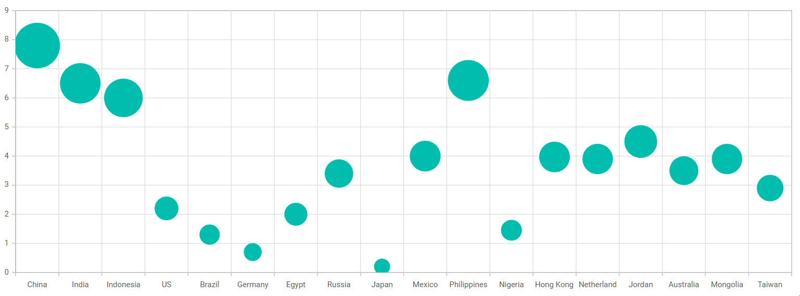

# How to change the bubble color on the cursor hover in bubble series

This article explains how to change the bubble color on the cursor hover in [Blazor Chart](https://www.syncfusion.com/blazor-components/blazor-charts) component.

## Features

* Render interactive Bubble charts with customizable data points.
* Change bubble colors dynamically when the cursor hovers over a bubble.
* Highlight specific data points to improve user interaction and data exploration.
* Customize hover styles to enhance chart visualization and user experience.
* Provide visual feedback for mouse interactions with chart elements.
* Configure bubble appearance using built-in chart events and customization APIs.
* Improve data readability by emphasizing hovered bubbles.
* Support interactive analysis of Bubble series data.
* Create engaging and responsive chart visualizations with hover effects.
* Demonstrate advanced Bubble chart customization techniques in Blazor Charts.

## Prerequisites

- Visual Studio 2026 or Visual Studio Code
- [.NET 10 SDK](https://dotnet.microsoft.com/download/dotnet/10.0)

## How to run the project

**Visual Studio 2026**:

* Checkout this project to a location in your disk.
* Open the project (`BubblePointHighlight.csproj`) file.
* Restore the NuGet packages.
* Run the project.

**Visual Studio Code**:

* Open the repository folder in Visual Studio Code.
* Open the integrated terminal.
* Navigate to the repository root.

```bash
cd How-to-change-the-bubble-color-on-the-cursor-hover-in-bubble-series
dotnet restore
dotnet run
```

Open the URL displayed in the terminal after the application starts.

## Sample code

**Highlighting the bubble point on mouse hover**:

[Blazor Chart](https://www.syncfusion.com/blazor-components/blazor-charts) provides support to change color of the Bubble points on mouse hover by using [HighLightColor](https://help.syncfusion.com/cr/blazor/Syncfusion.Blazor.Charts.SfChart.html#Syncfusion_Blazor_Charts_SfChart_HighlightColor) and [HighLightMode](https://help.syncfusion.com/cr/blazor/Syncfusion.Blazor.Charts.SfChart.html#Syncfusion_Blazor_Charts_SfChart_HighlightMode) property.

The color which needs to be changes is set to the [HighLightColor](https://help.syncfusion.com/cr/blazor/Syncfusion.Blazor.Charts.SfChart.html#Syncfusion_Blazor_Charts_SfChart_HighlightColor) property and the [HighLightMode](https://help.syncfusion.com/cr/blazor/Syncfusion.Blazor.Charts.SfChart.html#Syncfusion_Blazor_Charts_SfChart_HighlightMode) is set to **Point**.

The following code example demonstrates this.

**Index.razor**

```cshtml

@using Syncfusion.Blazor.Charts

<SfChart HighlightColor="red" HighlightMode="HighlightMode.Point">
    <ChartPrimaryXAxis ValueType="Syncfusion.Blazor.Charts.ValueType.Category"></ChartPrimaryXAxis>
    <ChartSeriesCollection>
        <ChartSeries DataSource="@SalesReports" XName="Text" YName="Y" Type="ChartSeriesType.Bubble" Size="Y">
        </ChartSeries>
    </ChartSeriesCollection>
</SfChart>

@code {

    public class ChartData
    {
        public double X { get; set; }
        public double Y { get; set; }
        public string Text { get; set; }
    }

    public List<ChartData> SalesReports = new List<ChartData>
    {
        new ChartData { X= 92.2, Y= 7.8, Text= "China" },
        new ChartData { X= 74, Y= 6.5, Text= "India" },
        new ChartData { X= 90.4, Y= 6.0, Text= "Indonesia" },
        new ChartData { X= 99.4, Y= 2.2, Text= "US" },
        new ChartData { X= 88.6, Y= 1.3, Text= "Brazil" },
        new ChartData { X= 99, Y= 0.7, Text= "Germany" },
        new ChartData { X= 72, Y= 2.0, Text= "Egypt" },
        new ChartData { X= 99.6, Y= 3.4, Text= "Russia" },
        new ChartData { X= 99, Y= 0.2, Text= "Japan" },
        new ChartData { X= 86.1, Y= 4.0, Text= "Mexico" },
        new ChartData { X= 92.6, Y= 6.6, Text= "Philippines" },
        new ChartData { X= 61.3, Y= 1.45, Text= "Nigeria" },
        new ChartData { X= 82.2, Y= 3.97, Text= "Hong Kong" },
        new ChartData { X= 79.2, Y= 3.9, Text= "Netherland" },
        new ChartData { X= 72.5, Y= 4.5, Text= "Jordan" },
        new ChartData { X= 81, Y= 3.5, Text= "Australia" },
        new ChartData { X= 66.8, Y= 3.9, Text= "Mongolia" },
        new ChartData { X= 78.4, Y= 2.9, Text= "Taiwan" }
    };
}

```

The following screenshot illustrates the output of the above code snippet.

**Output:**



**Conclusion**:

We hope you enjoyed learning how to change bubble color on cursor hover in Blazor Chart Component.

You can refer to our [Blazor Chart feature tour](https://www.syncfusion.com/blazor-components/blazor-charts) page to know about its other groundbreaking feature representations and [documentation](https://help.syncfusion.com/chart-sdk/blazor/charts/getting-started), and how to quickly get started for configuration specifications. You can also explore our [Blazor Chart example](https://blazor.syncfusion.com/demos/chart/line?theme=fluent2) to understand how to create and manipulate data.

For current customers, you can check out our components from the [License and Downloads](https://www.syncfusion.com/sales/pricing?category=ui-components) page. If you are new to Syncfusion, you can try our 30-day [free trial](https://www.syncfusion.com/downloads/blazor) to check out our other controls.

If you have any queries or require clarifications, please let us know in the comments section below. You can also contact us through our [support forums](https://www.syncfusion.com/forums), [support portal](https://support.syncfusion.com/support/tickets/create), or [feedback portal](https://www.syncfusion.com/feedback/chart-sdk). We are always happy to assist you!